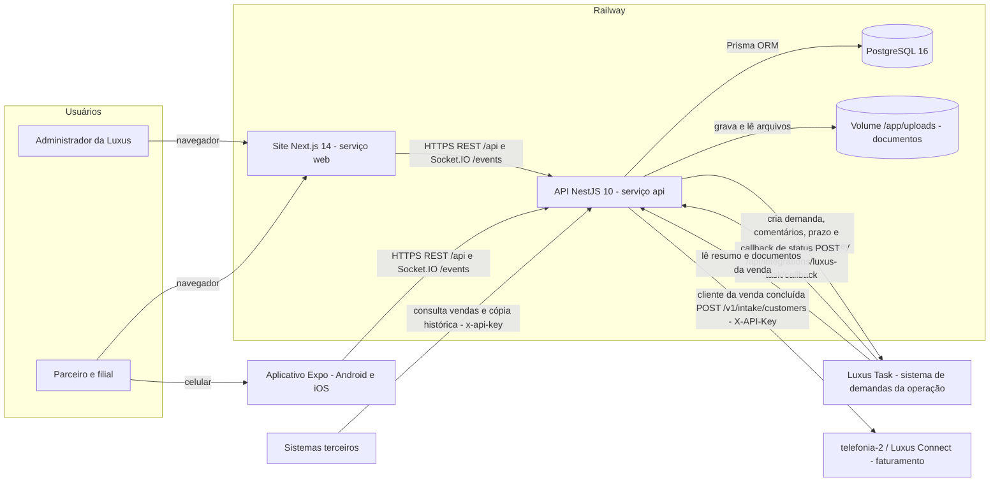
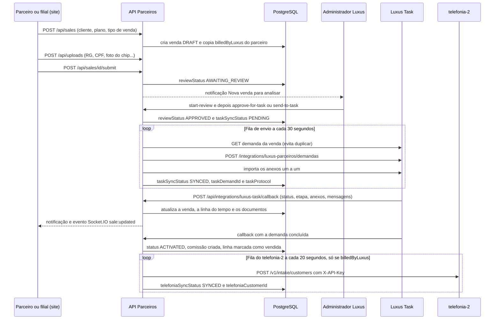
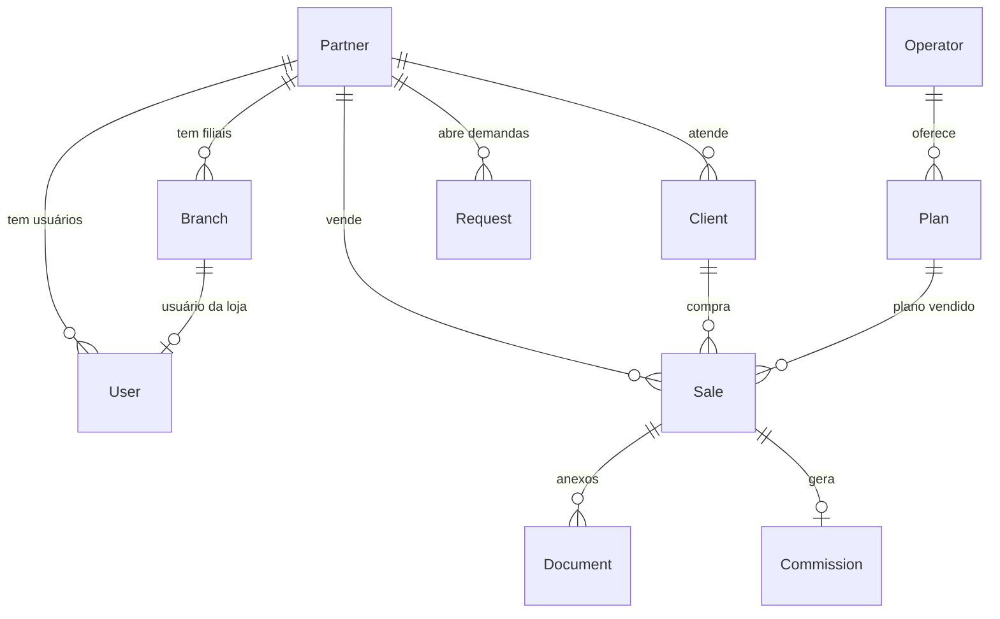

# Luxus Parceiros

Plataforma web (com aplicativo móvel) que a Luxus Telefonia (Grupo Luxus) usa para organizar a operação comercial feita por parceiros revendedores; é usada pelos administradores da Luxus e pelos parceiros e suas filiais (lojas). Ela cobre parceiros, filiais, usuários, clientes, vendas com documentação, estoque, planos, comissões, campanhas, financeiro, chamados, demandas e auditoria. O sistema está em produção na Railway, com o domínio web `parceiros.grupoluxus.com.br`, e em desenvolvimento contínuo.

> Histórico completo de versões, decisões técnicas e pendências: [docs/HISTORICO-DE-VERSOES.md](docs/HISTORICO-DE-VERSOES.md).
> Documentação de todos os sistemas: repositório privado `redobrai-del/documentacao-sistemas`.

## Arquitetura e funcionamento

### Visão geral

O Luxus Parceiros é um monorepo (um único repositório com vários aplicativos) com três aplicações que compartilham tipos e utilitários: a **API** NestJS (`apps/api`), o **site** Next.js (`apps/web`) e o **aplicativo móvel** Expo (`apps/mobile`). Só a API acessa o banco PostgreSQL e a pasta de arquivos enviados (documentos das vendas); o site e o aplicativo rodam no navegador ou no celular e conversam com a API por HTTPS (REST com JSON) e por Socket.IO (biblioteca de mensagens em tempo real sobre WebSocket). Em produção, a API e o site são dois serviços separados na Railway (plataforma de hospedagem de contêineres), cada um com seu Dockerfile, mais um PostgreSQL gerenciado e um volume persistente para os arquivos. As integrações com o Luxus Task, com o telefonia-2 (Luxus Connect) e com sistemas terceiros são chamadas HTTP servidor a servidor, autenticadas por chave em cabeçalho. As tarefas em segundo plano (filas de envio ao Task e ao telefonia-2) rodam dentro do próprio processo da API, com temporizadores; não há Redis, fila externa nem serviço de "worker" separado.



### Linguagens e onde cada uma é usada

| Linguagem | Onde | Papel |
| --- | --- | --- |
| TypeScript | `apps/api`, `apps/web`, `apps/mobile`, `packages/*` | Todo o código da API, do site, do aplicativo e dos pacotes compartilhados |
| Prisma Schema Language | `apps/api/prisma/schema.prisma` | Definição das tabelas, relações e enums (listas fixas de valores) do banco |
| SQL | `apps/api/prisma/migrations/*/migration.sql` | Migrations (scripts versionados que alteram o banco), geradas pelo Prisma e às vezes ajustadas à mão |
| JavaScript | `apps/api/test/*.test.js` | Testes automatizados, executados com `node:test` sobre o código compilado |
| CSS (Tailwind) | `apps/web` | Estilos do site |
| Shell (sh) | `docker/api-entrypoint.sh` | Inicialização do contêiner da API (migrations, seed opcional e início do servidor) |
| Dockerfile, YAML e TOML | `docker/`, `docker-compose.yml`, `railway*.toml` | Imagens, ambiente local e configuração da Railway |

### Como uma requisição percorre o sistema

Exemplo real: um usuário entra no site e abre a lista de vendas.

1. O usuário preenche e-mail e senha em `/login`. O site chama `POST /api/auth/login` (endereço base em `NEXT_PUBLIC_API_URL`).
2. Na API, todas as rotas passam por guardas globais registrados em `apps/api/src/app.module.ts`: `JwtAuthGuard` (exige token, exceto em rotas marcadas com `@Public()`), `RolesGuard` e `PermissionsGuard` (perfil e permissões) e `ThrottlerGuard` (limite de requisições). O login é público.
3. O `AuthService` compara a senha com o hash bcrypt (algoritmo de hash de senha) gravado em `users`, emite um token de acesso JWT (JSON Web Token, token assinado que identifica o usuário; validade padrão de 15 minutos) e um refresh token (token de renovação) gravado na tabela `refresh_tokens` para poder ser revogado.
4. O site guarda os tokens no navegador (`apps/web/src/lib/auth.ts`) e passa a chamar a API pela função `api()` de `apps/web/src/lib/api.ts`, que envia o cabeçalho `Authorization: Bearer <token>`. Ao abrir Vendas, chama `GET /api/sales` com os filtros da tela.
5. O `ValidationPipe` global valida os parâmetros contra o DTO (Data Transfer Object, classe que descreve os campos aceitos) e recusa campos desconhecidos. O `SalesController` repassa ao `SalesService`, que aplica o escopo do usuário (`partner-scope.ts` e `branch-scope.ts`) e consulta o PostgreSQL pelo Prisma (ORM, biblioteca que traduz código em SQL).
6. O `TransformInterceptor` embrulha a resposta no formato `{ success: true, data: ... }`; erros passam pelos filtros `HttpExceptionFilter` e `PrismaExceptionFilter`, que devolvem mensagens padronizadas.
7. Quando o token de acesso expira, a API responde 401; o site chama `POST /api/auth/refresh` uma única vez, troca os tokens e repete a requisição.
8. Alterações feitas por outros usuários chegam sem recarregar a página: a API emite eventos Socket.IO (por exemplo `sale:updated`) para as salas do usuário e do parceiro.

### Fluxo principal: a venda de ponta a ponta

A venda nasce no Parceiros, é executada no Luxus Task e, se a cobrança for pela Luxus, termina no telefonia-2. Três campos da tabela `sales` controlam esse caminho: `reviewStatus` (análise interna: `DRAFT`, `AWAITING_REVIEW`, `UNDER_REVIEW`, `CHANGES_REQUESTED`, `APPROVED`...), `taskSyncStatus` (envio ao Task: `NOT_READY`, `PENDING`, `PROCESSING`, `SYNCED`, `RETRY`, `FAILED`) e `status` (situação comercial; `ACTIVATED` significa venda concluída). O envio ao telefonia-2 usa `telefoniaSyncStatus`, com os mesmos valores do envio ao Task.



Passo a passo, com os pontos em que o código decide algo:

1. **Cadastro.** O parceiro cria a venda no site (`create-sale-dialog.tsx`), que chama `POST /api/sales`. A venda nasce com `reviewStatus = DRAFT` e herda `billedByLuxus` do cadastro do parceiro (`SalesService.partnerBilledByLuxus()`). Os documentos são enviados por `POST /api/uploads` e gravados no disco da API (pasta `UPLOAD_DIR` ou volume da Railway); no banco fica só o registro em `documents`.
2. **Envio para análise.** `POST /api/sales/:id/submit` (`SalesService.submitForReview`) exige formato do contrato (impressão ou ZapSign, serviço de assinatura eletrônica), os documentos obrigatórios do tipo de venda (`sale-documents.constants.ts`) e, no eSIM (chip virtual), IMEI (identificador do aparelho), EID (identificador do chip virtual) e sistema do aparelho. A venda vai para `AWAITING_REVIEW` e os administradores são notificados. O aplicativo móvel cria vendas e envia documentos, mas não chama `/submit` no código atual; a confirmar se essas vendas precisam ser enviadas para análise pelo site.
3. **Análise.** O administrador abre a análise (`start-review`, vira `UNDER_REVIEW`) e pode devolver para correção (`request-correction`, vira `CHANGES_REQUESTED`, e o parceiro corrige e reenvia) ou aprovar. Há duas formas de aprovar: `approve-for-task` (aprovação após a análise) e `send-to-task` (envio direto, marcado como `taskHandoff`, em que o Task conduz todo o restante). Nas duas, o administrador escolhe responsável, cliente e prazo do Task, e a venda fica com `taskSyncStatus = PENDING` e `contractStage = TASK_PROCESSING`.
4. **Criação da demanda no Task.** Um temporizador em `SalesService.onModuleInit` roda a fila a cada 30 segundos (e imediatamente após cada aprovação). Para cada venda pendente, `syncSaleToTask` marca a venda como `PROCESSING` (para que duas execuções não peguem a mesma venda), consulta se a demanda já existe no Task (`GET /integrations/luxus-parceiros/demandas/:id`), cria a demanda se não existir (`POST /integrations/luxus-parceiros/demandas`, com `source = luxus_parceiros` e o protocolo local da venda) e importa os anexos um a um em base64 (texto que representa o arquivo). Em caso de sucesso grava `taskDemandId`, `taskProtocol` e `SYNCED`; em caso de erro grava `RETRY`, a mensagem em `taskSyncError` e uma nova tentativa com espera crescente (de 30 segundos, dobrando a cada falha, até no máximo 15 minutos). Os administradores são avisados na primeira falha. Vendas presas em `PROCESSING` por mais de 5 minutos voltam para a fila.
5. **Execução e callback.** A equipe de operação trabalha a demanda no Task. A cada mudança, o Task chama `POST /api/integrations/luxus-task/callback` com o cabeçalho `x-integration-key` (conferido por `TaskIntegrationGuard`). `TaskIntegrationService.applyCallback` identifica se o callback é de uma venda ou de uma Demanda (tabela `requests`), atualiza status, responsável, quem está editando, última mensagem e etapa do contrato, baixa e grava os anexos novos (sem duplicar, pelo campo `documents.externalId`), registra na linha do tempo e notifica administradores e usuários do parceiro. Como reforço, caso algum callback se perca, `reconcileTaskProgress` consulta no Task, a cada 30 segundos, até 8 vendas em andamento sem atualização há mais de 1 minuto.
6. **Conclusão.** Quando o Task conclui a demanda, a venda passa a `status = ACTIVATED`, `contractStage = COMPLETED` e ganha `activatedAt`. Na mesma passagem, a linha usada é marcada como vendida, a comissão é criada (`CommissionsService.createFromSale`) e, se `billedByLuxus = true`, a venda entra na fila do telefonia-2. Depois de concluída, cancelada ou rejeitada, a venda não muda mais por callbacks.
7. **Faturamento.** `TelefoniaIntakeService` roda a cada 20 segundos e envia as vendas `ACTIVATED` com `billedByLuxus = true` para `/v1/intake/customers` do telefonia-2 (cabeçalho `X-API-Key`). Em caso de sucesso grava `telefoniaCustomerId` e `SYNCED`; em caso de erro, `RETRY` com espera crescente. Falhas nesse envio nunca desfazem a conclusão da venda.

### Outros fluxos

- **Demandas (menu "Demandas", tabela `requests`).** O administrador abre uma demanda avulsa (sem venda) que segue para o Task pelo mesmo mecanismo: `RequestsService` tem sua própria fila com temporizador, envia comentários ao Task e recebe status e respostas pelo mesmo callback.
- **Importação por planilha.** `POST /api/sales/import` (`sales-import.service.ts`) valida cada linha isoladamente e cria vendas novas, que seguem o fluxo acima, ou vendas já concluídas no Task (somente administrador).
- **Cópia histórica.** `POST /api/integrations/external/sales/historical` (`historical-sales.service.ts`) cria no Parceiros uma venda que já existe e foi concluída no Task, sem alterar o Task.

### Modelo de dados

O schema está em `apps/api/prisma/schema.prisma` (29 tabelas e 27 enums) e as alterações ficam em `apps/api/prisma/migrations/`. As principais entidades:



- `Partner` (`partners`): parceiro revendedor (matriz), com documento (CNPJ), status e a opção `billedByLuxus`. `Branch` (`branches`): filial ligada ao parceiro por `parentPartnerId`.
- `User` (`users`): usuário com perfil (`role`), opcionalmente ligado a um parceiro (`partnerId`) e a uma filial (`branchId`). `RefreshToken`, `Session`, `Permission` e `UserPermission` guardam sessões e permissões.
- `Client` (`clients`): cliente final, sempre dentro de um parceiro.
- `Operator`, `Plan` e `PartnerPlan`: operadoras, planos e planos liberados para cada parceiro. `Line`, `SimCard` e `StockMovement`: estoque de linhas, chips (identificados pelo ICCID, número de série impresso no chip) e suas movimentações.
- `Sale` (`sales`): a venda, com dados comerciais, campos de análise (`reviewStatus`), espelho do Task (campos `task*`) e controle do faturamento (campos `telefonia*`). `SaleTimeline` guarda o histórico de cada venda.
- `Document` (`documents`): metadados dos arquivos (nome, tipo, caminho em disco); pode pertencer a cliente, venda, demanda ou chamado. Anexos vindos do Task têm `externalId` no formato `task:<demanda>:<anexo>`.
- `Commission` e `CommissionRule`: comissão de cada venda concluída (uma por venda) e regras de cálculo.
- `Request`, `RequestComment`, `RequestTimeline`: Demandas integradas ao Task. `Ticket`, `TicketMessage`, `TicketTimeline`: chamados de suporte.
- `Campaign`, `FinancialRecord`, `Notification` e `AuditLog`: campanhas e metas, lançamentos financeiros, notificações e auditoria.

### Organização do código

- **API:** cada domínio em `apps/api/src/modules/<domínio>` segue `controller → service → Prisma`. O controller só recebe a requisição e declara permissões (`@RequirePermissions`, `@Roles`, `@Public`); a regra de negócio fica no service; as validações de entrada ficam nos DTOs (`dto/*.dto.ts`, com class-validator). Guardas, filtros, interceptadores e os helpers de escopo por parceiro e filial ficam em `apps/api/src/common`. O Socket.IO fica em `apps/api/src/gateway/events.gateway.ts`. As integrações têm módulos próprios: `task-integration` (cliente HTTP do Task, callback e anexos), `telefonia-intake` (fila e montagem do envio ao telefonia-2) e `external-sales` (API para terceiros e cópia histórica).
- **Site:** páginas em `apps/web/src/app` (App Router do Next.js; as telas autenticadas ficam em `(dashboard)`), componentes em `apps/web/src/components` e acesso à API, sessão, permissões e exportações em `apps/web/src/lib`. O site não tem rotas de API próprias: tudo passa pela API NestJS.
- **Aplicativo:** telas em `apps/mobile/app` (Expo Router) e cliente da API em `apps/mobile/src/services/api.ts`.
- **Compartilhado:** `packages/types` (tipos, enums, rótulos e permissões usados pela API, pelo site e pelo aplicativo), `packages/utils` e `packages/ui`.
- **Testes:** `apps/api/test`, com um arquivo por regra importante (escopo por parceiro, fluxo de análise, integração com o Task, telefonia-2, importação, cobrança do parceiro etc.). Não há testes automatizados no site nem no aplicativo.

## Funcionalidades

### Operação comercial

- Cadastro de parceiros (matriz) e filiais (lojas), cada um com seus usuários. Vários cadastros de parceiro podem compartilhar o mesmo CNPJ; a tela de Parceiros destaca quando isso acontece.
- Isolamento de dados aplicado na API: um parceiro nunca enxerga dados de outro, e usuários de filial enxergam apenas a própria loja.
- Planos e operadoras compartilhados entre a matriz e as filiais do mesmo parceiro.
- Estoque de linhas e chips, movimentações, transferências e leitura do ICCID pela câmera (web e aplicativo).
- Clientes com edição e exclusão, inclusive em lote, dentro do escopo do usuário.
- Vendas dos tipos linha nova, portabilidade (com operadora doadora), eSIM (com IMEI, EID, sistema do aparelho e foto da tela) e upgrade de plano a partir de uma venda anterior (copia cliente e documentos).
- Documentos da venda (RG, CPF, selfie, contrato, foto do chip etc.) com lista de obrigatórios que depende do tipo de venda. Anexos de qualquer tipo de arquivo, até 50 MB, podem ser incluídos, trocados ou excluídos enquanto a venda estiver aberta.
- Opção "cobrança pela Luxus" no cadastro do parceiro (marcada pelo administrador), que define se as vendas desse parceiro vão para o sistema de faturamento da Luxus depois de concluídas. Toda venda herda a opção do parceiro; sem marcação, a venda fica fora do faturamento. Ver "Atualização 1.13.0" abaixo.
- Edição da venda enquanto ela não estiver finalizada, com registro no histórico, e campos com contador que mostra quantos dígitos faltam (por exemplo RG e UF).
- Importação de vendas por planilha `.xlsx` (botão "Importar" em Vendas), em dois modos: "vendas novas", que seguem o fluxo normal até o Luxus Task, e "vendas já concluídas no Luxus Task" (somente administrador). Cada linha é validada isoladamente, até 300 linhas por arquivo.
- Exportação da lista de vendas e filtros por andamento, intervalo de datas e parceiro.

### Fluxo da venda com o Luxus Task

1. O parceiro ou a filial cadastra a venda, que entra em análise.
2. O administrador analisa a venda e a envia ao Luxus Task, escolhendo responsável, cliente e prazo (o prazo não pode ser anterior a hoje).
3. A equipe de operação executa a ativação no Task. O Parceiros espelha o andamento (quem está com a demanda, últimas mensagens, lembretes) e troca anexos com o Task nos dois sentidos.
4. A venda só é concluída quando o Task conclui a demanda. Nesse momento a venda passa a `ACTIVATED`, gera comissão e, se tiver cobrança pela Luxus, entra na fila de envio ao telefonia-2.

A aprovação interna e a finalização forçada que existiram no Parceiros foram desativadas; o Task é a fonte de verdade da conclusão (ver Versão 29 do histórico). O detalhe técnico deste fluxo (filas, callback e estados) está em "Arquitetura e funcionamento".

### Gestão e acompanhamento

- Dashboard administrativo e dashboard do parceiro, com períodos de mês, 30 dias, 60 dias e histórico. Vendas realizadas, receita, comissões e gráfico usam a data de criação da venda; cancelamentos usam a data do cancelamento.
- Somente vendas com status `ACTIVATED` contam como venda realizada em indicadores, rankings, campanhas e comissões.
- Cada indicador abre os registros que o compõem. O dashboard exporta planilha Excel com abas; as tabelas exportam PDF, CSV e TXT com colunas alinhadas.
- Campanhas e metas, comissões, financeiro, chamados com prazo (SLA) e Demandas (antigas Solicitações, restritas ao administrador e integradas ao Luxus Task).
- Notificações em tempo real com Socket.IO e janela de aviso para lembretes e conclusões vindos do Task.
- Auditoria das ações relevantes e histórico de atividades.
- Mapa de parceiros com Leaflet e busca de endereço por CEP.

### Experiência e conta

- Temas claro, escuro e sistema; menu lateral expansível e menu móvel em painel lateral.
- Foto de perfil com recorte, zoom e posicionamento; alteração de senha.
- Sessão persistente com renovação automática do token.
- Página "Guia de uso" (`/guia-de-uso`) com instruções por perfil e página "Esqueci minha senha".

## Stack

| Camada | Tecnologias |
| --- | --- |
| Monorepo | pnpm 9.15 (workspaces) e Turborepo 2; Node.js 20 ou superior; TypeScript 5.7 |
| API (`apps/api`) | NestJS 10, Prisma 6 com PostgreSQL 16, JWT com refresh token (Passport), Socket.IO 4 (namespace `/events`), Swagger, class-validator, Helmet e rate limiting (`@nestjs/throttler`) |
| Web (`apps/web`) | Next.js 14, React 18, Tailwind CSS 3, Radix UI (estilo shadcn/ui), Recharts, Leaflet, jsPDF, write-excel-file e read-excel-file, ZXing (leitor de ICCID) |
| Aplicativo (`apps/mobile`) | Expo 52 (React Native 0.76), Expo Router, Secure Store, biometria (`expo-local-authentication`) e câmera |
| Pacotes compartilhados | `packages/types` (tipos, enums, rótulos e permissões), `packages/utils` (utilitários) e `packages/ui` (componentes base) |
| Infraestrutura | Docker (`docker/api.Dockerfile` e `docker/web.Dockerfile`), Docker Compose com NGINX para ambiente local e Railway em produção |

Sobre o Redis: o Docker Compose sobe um Redis 7 e o `.env.example` traz `REDIS_URL`, mas o código atual da API não usa Redis (a biblioteca `ioredis` está apenas declarada como dependência). Ele não é necessário para rodar o sistema hoje.

## Estrutura de pastas

```text
Luxus Parceiros/
├── apps/
│   ├── api/                     # API NestJS
│   │   ├── prisma/              # schema.prisma, migrations (23), seed.ts e scripts de manutenção
│   │   ├── src/modules/         # um módulo por domínio (ver tabela abaixo)
│   │   ├── src/common/          # escopo por parceiro/filial, constantes e utilitários
│   │   ├── src/gateway/         # Socket.IO (namespace /events)
│   │   └── test/                # testes automatizados (node:test sobre o código compilado)
│   ├── web/                     # Next.js 14
│   │   └── src/app/(dashboard)/ # telas autenticadas
│   └── mobile/                  # aplicativo Expo
├── packages/                    # types, utils e ui compartilhados
├── docker/                      # Dockerfiles, nginx.conf e api-entrypoint.sh
├── docs/                        # histórico de versões e relatórios
├── docker-compose.yml           # ambiente local completo
├── railway.toml                 # serviço da API na Railway
└── railway.web.toml             # serviço web na Railway
```

Módulos da API (`apps/api/src/modules`): `auth`, `users` (inclui perfil), `partners`, `branches`, `clients`, `operators`, `plans`, `lines`, `sim-cards`, `stock`, `sales` (inclui importação por planilha), `commissions`, `campaigns`, `financial`, `requests` (Demandas), `tickets` (chamados), `notifications`, `audit`, `dashboard`, `uploads`, `task-integration` (Luxus Task), `external-sales` (API externa e cópia histórica do Task) e `telefonia-intake` (envio ao telefonia-2).

Telas da web (`apps/web/src/app/(dashboard)`): dashboard, vendas, clientes, parceiros, filiais, estoque, planos, operadoras, comissões, campanhas, financeiro, chamados, solicitações (menu "Demandas"), usuários, auditoria, perfil, configurações e guia de uso. Fora da área autenticada ficam `login` e `forgot-password`.

Outros arquivos na raiz: `HISTORICO_DE_VERSOES.txt` (histórico com numeração 0.1.0 a 1.14.0), `DOCUMENTACAO_COMPLETA.txt`, `RELATORIO_TECNICO.md` e `Luxus Parceiros.docx` (manual de processos). A pasta `__pycache__/` na raiz não faz parte do sistema e pode ser ignorada.

## Como rodar localmente

### Opção 1: Docker (recomendada)

Pré-requisitos: Docker Desktop com contêineres Linux em execução e Git. Não é preciso instalar Node.js nem PostgreSQL. As portas `3000`, `3001`, `5432`, `6379` e `8088` (NGINX) precisam estar livres em `127.0.0.1`.

1. Copie as variáveis de exemplo e troque `JWT_SECRET`, `JWT_REFRESH_SECRET` e `POSTGRES_PASSWORD` por valores próprios:

   ```powershell
   Copy-Item .env.example .env
   ```

2. Ajuste os endereços da web para a porta do NGINX. O NGINX local escuta em `127.0.0.1:8088` (variável `NGINX_PORT`), mas os valores padrão de `NEXT_PUBLIC_API_URL` e `NEXT_PUBLIC_WS_URL` ainda apontam para `http://localhost` (porta 80). No `.env`, use `NEXT_PUBLIC_API_URL=http://localhost:8088`, `NEXT_PUBLIC_WS_URL=http://localhost:8088/events` e inclua `http://localhost:8088` em `CORS_ORIGINS`. Como alternativa, aponte as duas variáveis diretamente para a API em `http://localhost:3001`.

3. Construa e inicie o ambiente:

   ```powershell
   docker compose up -d --build
   docker compose ps
   ```

| Serviço | Endereço |
| --- | --- |
| Aplicação via NGINX | http://localhost:8088 (ou a porta definida em `NGINX_PORT`) |
| Web direto | http://localhost:3000 |
| API direta | http://localhost:3001/api |
| Swagger | http://localhost:3001/api/docs |
| Verificação de saúde | http://localhost:3001/api/health |

Comandos úteis:

```powershell
docker compose logs -f api web        # acompanhar logs
docker compose up -d --build api web  # reconstruir após alteração
docker compose down                   # parar sem apagar banco nem uploads
```

Os contêineres se chamam `luxus-parceiros-*` e usam os volumes `postgres_data`, `redis_data` e `uploads_data`. Não rode `docker compose down -v` sem certeza, porque isso apaga os volumes locais (banco e documentos).

Ao iniciar, a API roda `prisma migrate deploy` e, se `RUN_DB_SEED=true` (padrão no Docker local), o seed idempotente de demonstração, que cria usuários de exemplo (administradores e um parceiro), operadoras, planos e dados básicos. Os e-mails e a senha inicial desses usuários estão em `apps/api/prisma/seed.ts`; use-os somente em ambiente local.

Observação: o `docker-compose.yml` não repassa à API as variáveis `LUXUS_TASK_TIMEOUT_MS` e `TELEFONIA_INTAKE_*`. Para testar a integração com o telefonia-2 no Docker local, é preciso acrescentá-las ao serviço `api`.

### Opção 2: sem Docker

Pré-requisitos: Node.js 20 ou superior, pnpm 9 (via Corepack) e um PostgreSQL 16 acessível pela `DATABASE_URL` do `.env`.

```powershell
corepack enable
corepack prepare pnpm@9.15.0 --activate
pnpm install
pnpm db:generate
pnpm db:migrate
pnpm db:seed
pnpm dev
```

O seed (`pnpm db:seed`) executa `dist/prisma/seed.js`; se ele não existir, compile a API antes com `pnpm --filter @luxus/api build`. Para trabalhar em um app específico:

```powershell
pnpm --filter @luxus/api dev     # API em watch (porta 3001)
pnpm --filter @luxus/web dev     # web em http://localhost:3000
pnpm --filter @luxus/mobile dev  # Expo
```

### Scripts da raiz

| Script | O que faz |
| --- | --- |
| `pnpm dev` | Sobe em paralelo todos os apps que têm script `dev` |
| `pnpm build` | Compila `types`, `utils`, `ui`, API e web, nessa ordem |
| `pnpm lint` | Verificação de tipos e lint de todos os pacotes |
| `pnpm test` | Compila a API e roda os testes de `apps/api/test` |
| `pnpm db:generate`, `db:migrate`, `db:seed`, `db:studio` | Prisma Client, migrations de desenvolvimento, seed e Prisma Studio |
| `pnpm db:cleanup` | Remove dados de demonstração (`prisma/cleanup-demo-data.ts`) |
| `pnpm docker:up`, `docker:down`, `docker:build` | Atalhos do Docker Compose |

Na API também existe `prisma:fix-sale-branch`, que corrige a filial de vendas antigas a partir de quem as criou.

### Testes

`pnpm test` roda os testes listados no script `test` de `apps/api/package.json` (isolamento por parceiro, documentos obrigatórios, status realizados, filtros do dashboard, edição e exclusão segura, fluxo de análise, integração com o Task, notificações de suporte, cópia histórica, telefonia-2, importação por planilha, cobrança no cadastro do parceiro, endurecimento de segurança e ciclo do refresh token). Três testes de `sale-review-workflow.test.js` e `task-integration.test.js` já falhavam antes da importação por planilha e continuam falhando; não são causados pelas mudanças recentes. Antes de enviar para a `main`, rode `pnpm build`: o deploy na Railway é automático e um erro de TypeScript derruba a publicação.

## Variáveis de ambiente

O arquivo de exemplo é `.env.example` na raiz. Nunca versione o `.env` nem valores reais.

| Variável | Onde é usada | Descrição |
| --- | --- | --- |
| `POSTGRES_PASSWORD` | Docker Compose | Senha do PostgreSQL local |
| `DATABASE_URL` | API (Prisma) | Conexão com o PostgreSQL |
| `REDIS_URL` | API | Opcional. Travas entre instâncias e contadores do bloqueio de login; sem Redis (ou se ele cair) a API usa a tabela `coordination_entries` do PostgreSQL |
| `JWT_SECRET`, `JWT_EXPIRES_IN` | API | Segredo e validade do token de acesso (padrão 15 minutos) |
| `JWT_REFRESH_SECRET`, `JWT_REFRESH_EXPIRES_IN` | API | Segredo e validade do token de renovação. Sem a variável, o código usa 365 dias; o `.env.example` e o Docker Compose sugerem 7 dias |
| `API_PORT`, `PORT` | API | Porta da API; `PORT` (definida pela Railway) tem prioridade |
| `API_URL` | `.env.example` | Endereço da API para referência local; não é lido pelo código atual |
| `CORS_ORIGINS` | API e Socket.IO | Origens do frontend autorizadas, separadas por vírgula |
| `NEXT_PUBLIC_API_URL`, `NEXT_PUBLIC_WS_URL` | Web (no build) | Endereço da API (com ou sem `/api` no final) e do Socket.IO (`.../events`). Ficam visíveis no navegador; não coloque segredos nelas |
| `EXPO_PUBLIC_API_URL`, `EXPO_PUBLIC_WS_URL` | Aplicativo | Mesmos endereços para o Expo (use o IP da máquina na rede local). Ficam embutidas no aplicativo |
| `JWT_ISSUER`, `JWT_AUDIENCE` | API | Emissor e público conferidos em todo token (padrão `luxus-parceiros-api` e `luxus-parceiros`). Trocar invalida as sessões abertas |
| `RUN_DB_SEED` | Entrypoint da API | `true` roda o seed de demonstração ao iniciar; mantenha `false` em produção |
| `SEED_ADMIN_PASSWORD`, `SEED_ALLOW_PRODUCTION` | Seed | Senha dos usuários demo (mínimo 12 caracteres, obrigatória). Com `NODE_ENV=production` o seed só roda com `SEED_ALLOW_PRODUCTION=true` |
| `TRUST_PROXY` | API | Quantos proxies confiáveis ficam na frente da API, para ler o IP real no bloqueio de login (padrão 1; NGINX + túnel = 2) |
| `APP_URL` | API | Endereço da web usado no link de redefinição de senha |
| `SMTP_HOST`, `SMTP_PORT`, `SMTP_USER`, `SMTP_PASS`, `SMTP_FROM` | API | Envio do e-mail de redefinição de senha |
| `MAIL_LOG_LINKS` | API | Só homologação: sem SMTP, escreve o link de redefinição no log da API |
| `ENABLE_SWAGGER` | API | `true` liga o Swagger em `/api/docs` também em produção (desligado por padrão) |
| `UPLOAD_DIR`, `UPLOAD_MAX_SIZE` | API | Pasta dos arquivos e tamanho máximo em bytes (padrão 50 MB) |
| `RAILWAY_VOLUME_MOUNT_PATH` | API | Usada como pasta de uploads quando `UPLOAD_DIR` não está definida |
| `THROTTLE_TTL`, `THROTTLE_LIMIT` | API | Janela (segundos) e número máximo de requisições do rate limiting |
| `LUXUS_TASK_API_URL`, `LUXUS_TASK_INTEGRATION_KEY`, `LUXUS_TASK_TIMEOUT_MS` | API | Endereço da API do Luxus Task, chave compartilhada (a mesma configurada no Task) e tempo limite das chamadas |
| `EXTERNAL_SALES_API_KEY` | API | Chave exigida pela API externa de vendas e pela cópia histórica |
| `TELEFONIA_INTAKE_URL`, `TELEFONIA_INTAKE_API_KEY`, `TELEFONIA_INTAKE_TIMEOUT_MS` | API | Origem do telefonia-2 (o caminho `/v1/intake/customers` é acrescentado), chave e tempo limite do envio. Sem URL ou chave, o envio fica aguardando |
| `NGINX_PORT` | Docker Compose | Porta local do NGINX (padrão 8088) |

## Autenticação e permissões

- Login por e-mail e senha (hash bcrypt), com token de acesso JWT de curta duração e refresh token revogável. A web guarda a sessão no armazenamento local do navegador e renova o token automaticamente (`apps/web/src/lib/api.ts`). O aplicativo usa Secure Store e biometria.
- Perfis (`UserRole`): `ADMIN` e `SUPERVISOR` (administração), `PARTNER` (dados do próprio parceiro), `ATTENDANT` (usuário de filial, limitado à loja) e `FINANCIAL` (comissões e financeiro). Permissões granulares por perfil ficam em `packages/types` e são conferidas na API e na web (`apps/web/src/lib/rbac.ts`).
- Visão global somente para `ADMIN`/`SUPERVISOR` sem vínculo com parceiro (`isPlatformAdmin`). Um administrador vinculado a um parceiro fica restrito a ele.

Regras obrigatórias para qualquer nova consulta na API:

1. Não confiar no `partnerId` enviado pelo navegador; usar os helpers de `apps/api/src/common/utils/partner-scope.ts`, que forçam o parceiro do usuário autenticado.
2. Aplicar também o filtro por `branchId` para usuários de filial (`branch-scope.ts`).
3. Ocultar elementos no frontend não substitui a autorização na API.

Outras proteções: Helmet, CORS restrito, rate limiting, bloqueio temporário de login (5 erros por conta e IP, 20 por conta, 50 por IP em 15 minutos), `ValidationPipe` que rejeita campos não declarados nos DTOs, limite de corpo por rota (1 MB por padrão; 5 MB em vendas, 10 MB na importação, 50 MB nas integrações), uploads conferidos pelo conteúdo do arquivo (magic bytes) e baixados como anexo, arquivos servidos somente com autenticação, CSV exportado sem fórmulas, dados bancários visíveis só para administrador e titular do parceiro (com auditoria de leitura), e auditoria. As integrações servidor-a-servidor usam chaves em cabeçalho HTTP.

Sessões: o refresh token é guardado só como hash SHA-256 e trocado a cada renovação. Reusar um token já trocado derruba toda a família de sessões (há 30 segundos de tolerância para abas ou requisições que renovam ao mesmo tempo); desativar o usuário ou trocar a senha derruba todas as sessões dele. A redefinição de senha usa token de uso único guardado como hash, válido por 1 hora, enviado por e-mail (telas `/forgot-password` e `/redefinir-senha`).

## Tempo real

O Socket.IO fica no namespace `/events` e exige o token JWT na conexão. Cada usuário entra na sala `user:<id>` e, se tiver parceiro, na sala `partner:<id>`. Eventos emitidos hoje: `sale:created`, `sale:updated`, `request:created`, `request:updated`, `request:comment`, `ticket:created`, `ticket:updated`, `ticket:message`, `ticket:deleted`, `commission:created`, `commission:approved`, `commission:paid`, `notification:new`, `notification:read` e `notification:read-all`. O evento antigo `notification` continua sendo emitido porque o aplicativo móvel ainda o escuta.

## Deploy

Produção na Railway, com dois serviços ligados a este repositório e um PostgreSQL. Cada push na `main` do remoto `origin` dispara nova publicação.

| Serviço | Configuração | Dockerfile | Verificação de saúde |
| --- | --- | --- | --- |
| API | `railway.toml` | `docker/api.Dockerfile` | `/api/health` |
| Web | `railway.web.toml` (definir em Settings, Config-as-code) | `docker/web.Dockerfile` | `/login` |

- API: variáveis mínimas `DATABASE_URL`, `JWT_SECRET`, `JWT_REFRESH_SECRET` e `CORS_ORIGINS` (incluindo o domínio web), além das variáveis das integrações. Mantenha `RUN_DB_SEED=false`. O contêiner roda `prisma migrate deploy` a cada inicialização (`docker/api-entrypoint.sh`).
- Volume obrigatório: conecte um volume persistente somente ao serviço da API, montado em `/app/uploads`. Sem ele, os documentos se perdem a cada publicação.
- Web: defina `NEXT_PUBLIC_API_URL` (domínio da API) e `NEXT_PUBLIC_WS_URL` (domínio da API com `/events`) como variáveis de build; elas são embutidas no build.
- Domínio web: `parceiros.grupoluxus.com.br`. O endereço público da API não está registrado neste repositório; o código do Luxus Task usa como padrão `https://luxusparceiros-production-df5d.up.railway.app`, o que indica ser a API de produção (a confirmar no painel da Railway).

Remotos Git: `origin` (`abelprosp/luxusparceiros`, de onde a Railway publica) e `redobrai` (`redobrai-del/luxus-parceiros`, cópia mantida pela REDOBRAI). Confira com `git remote -v` para onde está enviando.

Se o healthcheck falhar, confira se cada serviço usa o arquivo de configuração correto, as variáveis `PORT`, `DATABASE_URL` e `CORS_ORIGINS`, e os logs de inicialização. Se um deploy não for disparado após uma falha, use o redeploy do painel em vez de commits vazios.

## Integrações

### Luxus Task (sistema de demandas da operação)

Módulo `apps/api/src/modules/task-integration`. O Parceiros cria demandas no Task com o usuário técnico `LUXUSPARCEIROS`, envia dados e anexos (em base64) das vendas aprovadas e das Demandas, e recebe de volta status, respostas, anexos e a conclusão por callback. Vendas e demandas usam fila com nova tentativa automática, porque o Task pode demorar a responder.

| Rota (prefixo `/api`) | Uso |
| --- | --- |
| `POST /integrations/luxus-task/callback` | Callback do Task (protegido pela chave compartilhada) |
| `GET /integrations/luxus-task/sales/:saleId`, `.../documents`, `.../documents/:documentId` | Consulta de resumo e documentos da venda pelo Task |
| `GET /task-integration/responsibles`, `GET /task-integration/clients` | Listas de responsáveis e clientes do Task usadas nas telas |

Se o Task ficar fora do ar, as vendas não concluem (não há mais finalização forçada no Parceiros).

### telefonia-2 / Luxus Connect (faturamento)

Módulo `apps/api/src/modules/telefonia-intake`. Vendas concluídas com cobrança pela Luxus (opção herdada do cadastro do parceiro) entram em uma fila processada a cada 20 segundos e são enviadas para `/v1/intake/customers` do telefonia-2, com o cabeçalho `X-API-Key`. O envio nunca desfaz a conclusão da venda; dados fora do padrão vão para as observações.

### API externa de vendas (sistemas terceiros)

Módulo `apps/api/src/modules/external-sales`, autenticado pelo cabeçalho `x-api-key` (ou `x-integration-key`) comparado com `EXTERNAL_SALES_API_KEY`.

| Rota (prefixo `/api`) | Uso |
| --- | --- |
| `GET /integrations/external/sales` | Lista paginada. Filtros: `page`, `limit` (máximo 100), `search`, `status`, `partnerId`, `branchId`, `createdFrom`, `createdTo`, `onlyActivated` |
| `GET /integrations/external/sales/:idOrProtocol` | Detalhe por identificador ou protocolo |
| `POST /integrations/external/sales/historical` | Copia para o Parceiros uma demanda já existente no Task, sem alterá-la |
| `POST /integrations/external/sales/historical/rehome` | Move uma venda histórica copiada para o parceiro correto |

### Outros

- Busca de endereço por CEP (`apps/web/src/lib/cep.ts`) e mapa de parceiros com Leaflet.

## Atualização 1.13.0: cobrança pela Luxus no cadastro do parceiro

Situação: **em produção** desde 20/10/2026 (commit `f87ff4c`). Passou pela branch `homologacao` antes de ser mesclada na `main`.

### O que muda

| Antes | Depois |
| --- | --- |
| Quem cadastra a venda escolhe, venda a venda, se a cobrança é feita pela Luxus | O administrador marca uma única vez, no cadastro do parceiro, se a cobrança das vendas dele é feita pela Luxus |
| Escolha obrigatória no formulário de nova venda e editável na venda | O formulário de venda não pergunta mais; a venda herda a opção do parceiro |
| Coluna obrigatória "Cobrança pela Luxus" na planilha de importação | A coluna sai da planilha; a aba "Parceiros e lojas" mostra a cobrança de cada parceiro |
| Sem escolha não salvava a venda | Parceiro sem marcação = vendas fora do sistema de faturamento da Luxus |

Regras:

1. Parceiros novos e os que já existiam começam **desmarcados** (cobrança fora da Luxus) até o administrador marcar.
2. Ao marcar ou desmarcar no parceiro, as vendas dele **ainda não concluídas** passam a seguir a nova opção. Vendas concluídas, canceladas ou rejeitadas ficam como terminaram (as concluídas que já foram ao faturamento não mudam).
3. Usuários do próprio parceiro não alteram essa opção, mesmo editando os dados do parceiro; só o administrador.
4. Na migração, as vendas em aberto ficam desmarcadas (seguem os parceiros, que começam desmarcados). Depois de publicar, o administrador deve marcar os parceiros cobrados pela Luxus; nesse momento as vendas em aberto deles voltam a ir para o faturamento quando concluírem.
5. Vendas criadas pela importação por planilha, pela cópia histórica do Task e pela troca de parceiro de uma venda histórica também seguem o parceiro.

### Como foi feito

- **Banco:** migration `20261020120000_partner_billed_by_luxus` cria `partners.billedByLuxus` (padrão `false`), muda o padrão de `sales.billedByLuxus` para `false` e desmarca as vendas em aberto (status diferente de `ACTIVATED`, `CANCELLED` e `REJECTED`).
- **API:**
  - `partners`: campo opcional `billedByLuxus` no cadastro e na edição. Na edição, se o valor mudar, o parceiro e as vendas em aberto são atualizados na mesma transação. Usuário com `partnerId` (o próprio parceiro) é ignorado nesse campo.
  - `sales`: `SalesService.partnerBilledByLuxus()` lê a opção do parceiro, e `create()` grava esse valor na venda. O campo `billedByLuxus` enviado pelo navegador é aceito e ignorado (para não quebrar telas antigas em cache), e a edição da venda não muda mais a cobrança.
  - Importação por planilha e `external-sales` (cópia histórica e troca de parceiro) usam a opção do parceiro.
  - O envio ao telefonia-2 não mudou: continua enviando só vendas concluídas com `billedByLuxus = true`.
- **Web:** caixa "A cobrança das vendas deste parceiro é feita pela Luxus" no formulário de parceiro (`parceiros/page.tsx`); escolha removida de `create-sale-dialog.tsx` e `edit-sale-dialog.tsx`; o detalhe da venda continua mostrando se ela vai ou não para o faturamento; coluna removida da planilha (`lib/sales-import.ts`); Guia de uso atualizado.
- **Testes:** `test/partner-billing.test.js` (mudança no parceiro leva as vendas em aberto; salvar sem mudar não mexe nas vendas; parceiro não altera a própria cobrança) e `test/sales-import.test.js` ajustado. Os dois entraram no script `pnpm test`.
- **Efeito colateral positivo:** o aplicativo móvel nunca enviava a escolha de cobrança, que era obrigatória na API; com a mudança, a criação de venda pelo aplicativo deixa de ser recusada por isso.

### Como conferir

Roteiro sugerido:

1. Editar um parceiro e marcar "A cobrança das vendas deste parceiro é feita pela Luxus"; criar uma venda para ele e conferir, no detalhe, "Vai para o sistema de faturamento da Luxus".
2. Criar uma venda para um parceiro desmarcado e conferir "Não vai para o sistema de faturamento da Luxus".
3. Com uma venda em análise, desmarcar o parceiro e conferir que a venda mudou; conferir que uma venda concluída não mudou.
4. Entrar como usuário do parceiro e conferir que a opção não aparece e não muda.
5. Baixar a planilha de importação e conferir que a coluna de cobrança sumiu e que a aba "Parceiros e lojas" mostra a cobrança.

### Depois da publicação

Marcar no cadastro os parceiros cobrados pela Luxus. Até isso ser feito, nenhuma venda desses parceiros vai para o faturamento.

## Atualização 1.14.0: segurança, consistência e usabilidade

Situação: **em produção** desde 23/10/2026 (commit `8fa69c9`; o deploy saiu com `00df38e`, depois da instabilidade da Railway). Passou pela homologação (túnel Cloudflare, banco próprio) e foi aprovada nos testes antes de ser mesclada na `main`.

São 30 ajustes, agrupados abaixo.

### Segurança e isolamento entre parceiros

**Por quê:** uma revisão do código encontrou caminhos em que um parceiro conseguia agir sobre dados de outro (excluir em massa por id, assumir linha ou chip pelo estoque, anexar arquivo a cliente alheio, baixar anexo do Task de venda que não enxerga) e pontos que facilitavam roubo de sessão ou de conta (refresh token em texto puro e válido para sempre, login sem limite de tentativas, Swagger aberto, upload aceito só pelo nome do arquivo). Cada item abaixo fecha um desses caminhos.

1. Exclusão em massa de vendas e solicitações respeita o parceiro e a filial de quem exclui.
2. Administrador vinculado a parceiro não altera comissão personalizada, status de venda nem o catálogo (operadoras, planos, campanhas); isso fica com a Luxus.
3. Estoque e importação não "sequestram" linha ou chip de outro parceiro: o número já cadastrado em outro parceiro é recusado em vez de mudar de dono.
4. Upload com `clientId` confere se o cliente é do parceiro e da filial de quem envia.
5. O proxy de anexos do Task confere se o usuário enxerga a venda dona do anexo.
6. A correlação de linha com o Task usa o número completo (antes bastavam os 8 últimos dígitos).
7. Seed seguro por padrão: não roda em produção sem `SEED_ALLOW_PRODUCTION=true` e exige `SEED_ADMIN_PASSWORD` forte; o Compose não tem mais senha padrão.
8. Uploads conferidos pelo conteúdo (magic bytes) contra uma lista de tipos permitidos; downloads saem como anexo com `nosniff`.
9. Refresh token guardado como hash, trocado a cada renovação, com detecção de reuso e revogação ao desativar usuário, trocar senha ou mudar parceiro/filial.
10. Dados bancários e PIX do parceiro só para administrador e titular; os demais recebem os campos vazios e a leitura é auditada.
11. CSV exportado neutraliza fórmulas (`=`, `+`, `-`, `@`); chamados ficam restritos ao parceiro e à filial.
12. Multer 2 e limite de corpo por rota (1 MB padrão).
13. Listagens com limite máximo, GET sem efeitos colaterais, validação de DTOs e de intervalos de datas.
14. Swagger desligado em produção (`ENABLE_SWAGGER`), JWT com algoritmo HS256 fixo e `iss`/`aud` conferidos, cabeçalhos de segurança no NGINX.
15. Bloqueio temporário de login por conta, IP e conta+IP, e `TRUST_PROXY` para ler o IP real.
16. Redefinição de senha por e-mail com token de uso único guardado como hash (1 hora).

### Consistência dos dados

**Por quê:** havia situações em que o sistema ficava incoerente: venda cancelada com comissão ainda válida, cliente excluído deixando arquivos e vínculos para trás, venda usando linha ou chip de outro parceiro ou de outra operadora, comissão perdida quando a geração falhava no meio, e dashboard lento por carregar todas as vendas na memória. Com mais de uma instância da API, as filas também podiam rodar em dobro.

17. Ciclo de vida da comissão: venda que deixa de estar ativada cancela a comissão; comissão já paga bloqueia o cancelamento ou a rejeição até o estorno.
18. Exclusão de cliente bloqueada quando há venda ativada, vínculo com o Task ou comissão paga; nos demais casos os arquivos do cliente também são apagados.
19. Linha, chip e plano da venda precisam ser do mesmo parceiro e coerentes entre si (plano ativo, operadora compatível, linha/chip livres).
20. Cadastro de usuário confere se o parceiro e a filial existem e combinam.
21. Índices novos em vendas, clientes, documentos, comissões, notificações e sessões. A view `client_document_duplicates` lista clientes repetidos por documento, a unificar antes de criar a restrição de unicidade.
22. Outbox: a comissão da venda ativada é gerada por uma fila persistida, com nova tentativa e espera crescente (até 10 tentativas).
23. Dashboard calculado com agregações no banco e cache de 60 segundos.
24. `/api/health/ready` confere banco e Redis; travas entre instâncias (Redis ou PostgreSQL) evitam que duas réplicas processem a mesma fila; o reset de senha e os contadores de login ficam persistidos.

### Usabilidade e acessibilidade

**Por quê:** as listas carregavam só a primeira página sem aviso, um erro de rede deixava a tela vazia sem saída, Chamados não aparecia no menu, o Kanban só funcionava arrastando com o mouse, e exclusões usavam a caixa de confirmação do navegador. No app, a venda nova ficava em rascunho e não chegava à análise, e usuários sem permissão viam o botão "Nova demanda" para depois receber erro.

25. Chamados no menu (web e app); "Nova demanda" no app só para administrador; exclusões confirmadas por modal padrão (parceiros, operadoras, planos, campanhas e documentos da venda).
26. Tela de erro com "Tentar novamente" nas listagens da web e do app.
27. Paginação real: "Carregar mais" na web e rolagem infinita no app.
28. Acessibilidade: contraste maior, zoom liberado no celular, rótulos ligados aos campos, cabeçalhos de tabela e botões só com ícone com nome acessível.
29. Kanban de chamados e solicitações com menu "Alterar status" (funciona por teclado, sem arrastar).
30. App: a venda nova é enviada para análise depois dos anexos (antes ficava em rascunho); vendas em rascunho mostram o botão "Enviar para análise".

### Como foi feito

- **Banco:** migration `20261020180000_security_hardening` (tabelas `password_reset_tokens`, `coordination_entries` e `outbox_events`; colunas `familyId` e `rotatedAt` em `refresh_tokens`, com conversão dos tokens existentes para hash sem derrubar sessões; ação de auditoria `VIEW`; índices; view de clientes duplicados).
- **API:** novos `common/coordination` (travas e contadores), `common/mail` (SMTP), `modules/outbox`, `auth/login-throttle.service.ts`, `commissions/commission-lifecycle.ts` e utilitários em `common/utils` (`bank-data`, `csv`, `date-range`, `file-signature`, `jwt-options`, `session-revocation`, `token-hash`).
- **Web:** `hooks/usePaginatedList.ts`, `components/ui/error-state.tsx` (inclui "Carregar mais"), `components/ui/kanban-status-menu.tsx` e a tela `/redefinir-senha`.
- **App:** `hooks/useInfiniteList.ts`, `components/ui/ErrorState.tsx` e envio da venda para análise.
- **Testes:** `test/security-hardening.test.js` e `test/auth-refresh.test.js`, incluídos no `pnpm test`. Resultado: 73 aprovados e os mesmos 3 que já falhavam antes.
- **Correção achada na homologação:** a primeira versão da migration recriava o índice `sales_simCardId_idx`, que já existe desde `20260701180000_sale_process_fields`, e travava a API na inicialização. A linha foi retirada; depois disso o banco ficou idêntico ao `schema.prisma` (`prisma migrate diff` vazio).

### Como conferir

Roteiro sugerido na homologação (entrar como administrador, como parceiro e como usuário de filial):

1. **Isolamento:** como parceiro, tentar excluir em massa, abrir ou anexar arquivos em vendas e clientes de outro parceiro: deve ser recusado. Cadastrar no estoque uma linha que já é de outro parceiro: deve ser recusado.
2. **Admin de parceiro:** conferir que não altera comissão personalizada, status da venda, operadoras, planos nem campanhas.
3. **Dados bancários:** como atendente, abrir o parceiro e conferir que banco e PIX não aparecem.
4. **Login:** errar a senha 5 vezes seguidas e conferir a mensagem de bloqueio temporário (15 minutos para aquela conta naquele IP).
5. **Senha:** "Esqueci minha senha" na tela de login, abrir o link (na homologação ele aparece no log da API), definir a senha nova e conferir que o link não funciona uma segunda vez.
6. **Comissão:** ativar uma venda e conferir a comissão; cancelar a venda e conferir a comissão cancelada; com comissão paga, conferir que o cancelamento é bloqueado.
7. **Cliente:** tentar excluir um cliente com venda ativada (bloqueado) e um sem vendas (excluído).
8. **Venda:** escolher linha ou chip de outra operadora que não a do plano: deve ser recusado.
9. **Listas:** em clientes, usuários, estoque, comissões etc., usar "Carregar mais"; no app, rolar até o fim das listas.
10. **Erro:** desligar a internet, abrir uma lista, conferir "Tentar novamente" e religar.
11. **Kanban:** em Chamados e Solicitações, usar o menu "Alterar status" pelo teclado (Tab e Enter).
12. **App:** criar uma venda com anexos e conferir que ela chega "em análise" no painel.
13. **Exportação:** exportar um CSV com um cliente cujo nome começa com `=` e conferir que o Excel não executa fórmula.

### Ambiente de homologação

Roda na máquina local com Docker e é exposto por um túnel rápido do Cloudflare (endereço `*.trycloudflare.com`). Usa banco próprio (projeto Docker `luxus-homolog`, com volumes separados) e **não** se conecta ao banco de produção, ao Luxus Task nem ao telefonia-2.

1. Iniciar o túnel: `cloudflared tunnel --no-autoupdate --url http://localhost:8088` e anotar o endereço `https://....trycloudflare.com`.
2. Criar `.env.homolog` na raiz (ignorado pelo Git) com `POSTGRES_PASSWORD`, `JWT_SECRET`, `JWT_REFRESH_SECRET` e `SEED_ADMIN_PASSWORD` aleatórios, `RUN_DB_SEED=true`, `SEED_ALLOW_PRODUCTION=true`, `TRUST_PROXY=2`, `MAIL_LOG_LINKS=true`, e `APP_URL`, `CORS_ORIGINS` e `NEXT_PUBLIC_API_URL` com o endereço do túnel (`NEXT_PUBLIC_WS_URL` com `/events` no final). Deixar vazias as chaves do Task e do telefonia-2.
3. Subir: `docker compose -p luxus-homolog --env-file .env.homolog up -d --build`.
4. Entrar com `admin@luxus.com.br` e a senha de `SEED_ADMIN_PASSWORD`. O link de "Esqueci minha senha" aparece em `docker logs luxus-parceiros-api`.

O endereço do túnel muda toda vez que o `cloudflared` reinicia; nesse caso, atualize o `.env.homolog` e rode o passo 3 de novo (a web embute o endereço no build).

### Antes de publicar

- **E-mail de redefinição (adiado por decisão em 21/10/2026):** a versão pode ser publicada sem servidor de e-mail. Enquanto `SMTP_HOST`, `SMTP_PORT`, `SMTP_USER`, `SMTP_PASS`, `SMTP_FROM` e `APP_URL` não forem configurados na Railway, a tela "Esqueci minha senha" informa que o e-mail foi enviado, mas nada chega (em produção o link não é escrito no log). Nesse período, a troca de senha é feita pelo administrador na tela de Usuários. Para ativar depois, basta uma conta de envio da Luxus (um único remetente envia para Gmail, Hotmail ou domínio próprio) e os registros SPF, DKIM e DMARC no DNS de `grupoluxus.com.br`.
- **Proxy:** conferir `TRUST_PROXY` (padrão 1, adequado para a Railway com um proxy na frente). Valor errado faz o bloqueio de login contar todos os usuários como um único IP.
- **Variáveis que não podem existir em produção:** `RUN_DB_SEED` deve continuar `false`, e `MAIL_LOG_LINKS` e `ENABLE_SWAGGER` não devem ser definidas.
- **Aplicativo:** as mudanças do app (itens 25 a 30 na parte do celular) só chegam aos usuários com um novo build do Expo. A publicação na Railway atualiza apenas a API e a web.

### Efeitos esperados na publicação

- A migration converte os refresh tokens existentes para hash: ninguém precisa entrar de novo por causa disso.
- Os tokens de acesso emitidos antes da publicação não têm `iss`/`aud` e passam a ser recusados; web e app renovam sozinhos com o refresh token, então o usuário não percebe (no máximo uma requisição repetida).
- Como o corpo das requisições passou a ter limite por rota (1 MB por padrão), integrações que enviem JSON grande fora de `/api/integrations/`, `/api/sales` e `/api/sales/import` receberão erro 413.

### Depois da publicação

- Conferir a view `client_document_duplicates` e unificar os clientes repetidos antes de criar a restrição de unicidade.
- Acompanhar em `/api/health/ready` (banco e Redis) e os eventos com falha na tabela `outbox_events`.
- Atualizar a situação desta seção e dos dois históricos para "em produção", com o commit publicado.

## Pontos de atenção

Resumo; detalhes na seção 7 de [docs/HISTORICO-DE-VERSOES.md](docs/HISTORICO-DE-VERSOES.md).

- Credenciais de demonstração: se o seed já rodou em produção, as contas de exemplo existem lá. Confirme `RUN_DB_SEED=false` e que essas contas foram removidas ou tiveram a senha trocada.
- Refresh token com validade padrão de 365 dias no código quando `JWT_REFRESH_EXPIRES_IN` não está definida.
- Dependência do Luxus Task para concluir vendas, sem procedimento de contingência documentado.
- Aplicativo móvel sem mudanças desde 24/08/2026: eSIM, upgrade e importação podem não existir nele (a cobrança pela Luxus vem do parceiro e não depende do aplicativo).
- Docker local com endereços padrão da web apontando para a porta 80, enquanto o NGINX usa a 8088 (ver "Como rodar localmente").
- Redis é opcional: sem ele, travas e contadores usam o PostgreSQL (a partir da 1.14.0).
- Duas numerações de versão (`docs/HISTORICO-DE-VERSOES.md` e `HISTORICO_DE_VERSOES.txt`) e muitas branches antigas já mescladas.

## Convenções

- Commits no formato `tipo: descrição` (por exemplo `feat: ...`, `fix: ...`, `docs: ...`), com mensagens descritivas.
- Nunca commitar `.env`, planilhas, documentos de clientes ou dados pessoais. A pasta `uploads/` local é ignorada pelo Git.
- Toda alteração no `schema.prisma` deve vir com migration; não edite migrations já aplicadas em produção.
- Na API, cada domínio tem controller, service, DTOs (validados com class-validator e documentados no Swagger) e módulo; regras ficam no service, e ações sensíveis são auditadas.
- Na web, chamadas autenticadas passam por `apps/web/src/lib/api.ts`; tipos usados por mais de um app ficam em `packages/types`.
- Antes de publicar, rode `pnpm build` e `pnpm test` e teste com um administrador, um parceiro e um usuário de filial.
- Ao publicar, acrescente a nova versão em `docs/HISTORICO-DE-VERSOES.md`.

## Licença

Software proprietário da Luxus Telefonia.
